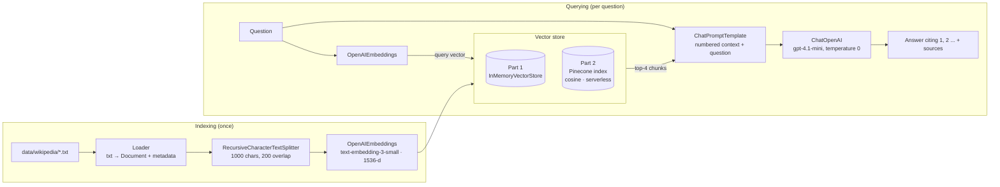
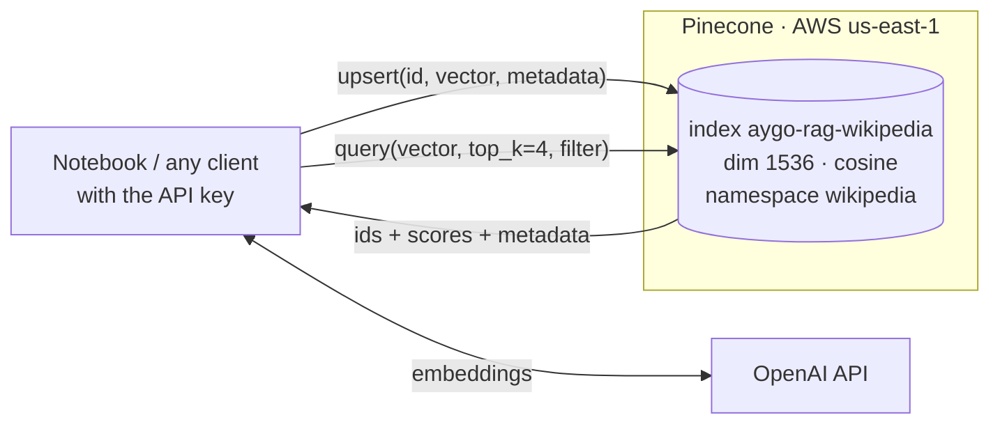

# AYGO-RAG-and-Vector-Databases

This project builds a **Retrieval-Augmented Generator (RAG)**: a question-answering system that, instead of answering from the language model's memory alone, first looks up the most relevant passages in a knowledge base and then asks the model to answer using only those passages, citing them.

The knowledge base is six English Wikipedia articles on the topic of the lab itself: *Retrieval-augmented generation*, *Vector database*, *Word embedding*, *Large language model*, *Transformer (deep learning)* and *Semantic search*. The system is built twice in a single Jupyter notebook:

1. **Part 1** uses LangChain and OpenAI, with the vectors kept in memory (`InMemoryVectorStore`).
2. **Part 2** replaces that store with a **Pinecone** serverless index. Everything else stays the same, and the notebook ends with a comparison of the two implementations.

## Architecture

A RAG system has two pipelines. Indexing runs once and turns the documents into searchable vectors. Querying runs for every question.



Each article is split into chunks of about 1000 characters, with 200 characters of overlap so that a sentence cut at a boundary still appears whole in one of the two chunks. Each chunk is converted into a 1536-dimensional vector by OpenAI's embedding model. Texts with similar meaning produce vectors that point in similar directions, even when they share no words.

When a question arrives, it is converted into a vector with the same model. The vector store returns the 4 chunks with the highest cosine similarity. Those chunks are numbered and placed in the prompt, together with instructions to answer only from them, cite their numbers, and say "I don't know" when the context does not contain the answer. The chat model writes the answer, and the notebook prints it with the source articles and URLs.

In LangChain the querying pipeline is a single LCEL chain:

```python
RunnableParallel(docs=retriever, question=RunnablePassthrough()).assign(
    answer=format_context | prompt | ChatOpenAI(...) | StrOutputParser()
)
```

The chain is built by `build_rag_chain(retriever)`. Both vector stores implement LangChain's `VectorStore` interface, so moving from Part 1 to Part 2 means changing one constructor and passing a different retriever. The prompt, the model and the chain do not change.

The notebook also includes the variant used by the LangChain RAG tutorial referenced by the lab: retrieval exposed as a **tool** of an agent (`create_agent`), which lets the model decide when to search and run several searches for compound questions.

### Role of Pinecone



Pinecone stores and searches the vectors; OpenAI still computes them on the client side. LangChain's `PineconeVectorStore` saves each chunk's text and metadata (title, URL, position) with its vector, so search results come back as normal LangChain `Document`s. Each chunk gets a deterministic ID (a hash of its URL and its position in the article), so re-running the upload overwrites the vectors instead of duplicating them. The same IDs are used in both parts, which lets the notebook check whether both stores return the same chunks.

Compared with the in-memory store, Pinecone keeps the vectors after the program stops. The notebook shows this by reconnecting to the index without embedding anything. Pinecone can also be shared by any process, filters by metadata inside the database, and uses approximate nearest-neighbour indexes that stay fast as the corpus grows.

## Results

From the run saved in the notebook. Timings vary slightly between runs.

| | InMemoryVectorStore | Pinecone |
|---|---|---|
| Indexing 308 chunks (incl. embeddings) | ~1.5 s | ~3.5 s |
| Median search latency (vector store only) | ~10 ms | ~107 ms |
| Same top-4 chunks as in-memory | — | 6 / 6 questions, same order |
| Survives a restart / shared between processes | no / no | yes / yes |

Both stores return the same chunks, and the answers are the same. The in-memory search is faster because it runs inside the process, while each Pinecone search is a network round trip to AWS. That gap is small next to the 1–3 s the chat model takes to answer. Pinecone's advantages are persistence, sharing, filtering and scale, not latency on a corpus this small. Section 4 of the notebook has the full comparison and discussion.

## Repository structure

```
.
├── rag_langchain_pinecone.ipynb   # the workshop: architecture, Part 1, Part 2, comparison
├── data/wikipedia/                # sample knowledge base (6 Wikipedia articles as .txt)
├── scripts/download_wikipedia.py  # regenerates data/wikipedia/ from the Wikipedia API
├── requirements.txt
├── .env.example                   # template for the API keys
└── README.md
```

## Installation and setup

### Prerequisites

- Python 3.10 or newer (developed with 3.11).
- An **OpenAI API key** with available credit: https://platform.openai.com/api-keys. One full run of the notebook costs a few US cents.
- A **Pinecone API key**. The free Starter plan is enough. Sign up at https://app.pinecone.io and copy the key from *API Keys*. You do not need to create an index; the notebook creates it.

### 1. Clone and create a virtual environment

```bash
git clone https://github.com/bricenojuliana/AYGO-RAG-and-Vector-Databases.git
cd AYGO-RAG-and-Vector-Databases

python -m venv .venv
source .venv/bin/activate          # Windows: .venv\Scripts\activate
pip install -r requirements.txt
```

With [uv](https://docs.astral.sh/uv/) the same thing is `uv venv && uv pip install -r requirements.txt`.

### 2. Configure the API keys

```bash
cp .env.example .env
```

Edit `.env` and set your keys:

```
OPENAI_API_KEY=sk-...
PINECONE_API_KEY=pcsk_...
```

`.env` is listed in `.gitignore`, so the keys are never committed. Two optional variables are also read: `OPENAI_CHAT_MODEL`, which defaults to `gpt-4.1-mini`, and `PINECONE_INDEX_NAME`, which defaults to `aygo-rag-wikipedia`.

### 3. Run the notebook

```bash
jupyter notebook rag_langchain_pinecone.ipynb
```

Then choose *Run → Run All Cells*. To run it headless and save the outputs into the file:

```bash
jupyter nbconvert --to notebook --execute --inplace rag_langchain_pinecone.ipynb
```

The first run creates the Pinecone index `aygo-rag-wikipedia`, which takes a few seconds. Later runs reuse it. When you are finished, set `DELETE_INDEX = True` in the last cell and run it to delete the index.

### Optional: refresh the knowledge base

The articles are already in `data/wikipedia/`, so the notebook does not need internet access to Wikipedia. To download the current versions:

```bash
python scripts/download_wikipedia.py
```

To use other articles, edit the `ARTICLES` list in that script.

## Technologies

- [LangChain](https://docs.langchain.com/) 1.x: `langchain`, `langchain-core`, `langchain-text-splitters`
- [langchain-openai](https://docs.langchain.com/oss/python/integrations/providers/openai): `OpenAIEmbeddings`, `ChatOpenAI`
- [langchain-pinecone](https://docs.langchain.com/oss/python/integrations/vectorstores/pinecone) and the `pinecone` Python SDK
- Jupyter Notebook, pandas, python-dotenv

## References

- LangChain RAG tutorial: https://docs.langchain.com/oss/python/deepagents/rag
- LangChain Pinecone integration: https://docs.langchain.com/oss/python/integrations/vectorstores/pinecone
- Wikipedia articles used as the knowledge base (CC BY-SA 4.0), linked in the first lines of each file in `data/wikipedia/`.
